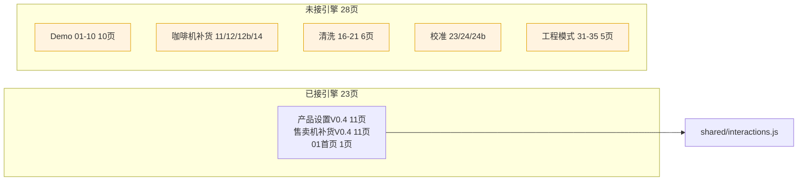

# 交互层审计与统一方案（不动代码版）

> 目标：把整套平台做成可交互（含键盘输入等），用**一个统一的交互层**覆盖所有页面。
> 本文仅做现状审计与方案规划，**未修改任何源码**。
> 权威代码：`/Users/qian2/Downloads/ui-prototype`

---

## 1. 现状一句话总结

当前已有一套**声明式交互引擎** `shared/interactions.js`（靠 HTML 的 `data-*` 属性驱动，无需每页写 JS），但**只接到了 23/51 个页面**，其余 28 页完全没有任何交互层；且引擎本身还缺几类"让全站都能交互"所必需的控件能力（标签页、文本输入、开关、下拉、滑块等）。

---

## 2. 已发现的问题清单（按严重程度）

### 🔴 P0 · 覆盖缺口：28 页完全没有交互层
全站 51 页中，仅以下 23 页引入了 `<script src="../shared/interactions.js" defer>`：
`01, 13, 15, 15b, 15c, 16(vm), 17(vm), 18(vm), 19(vm), 20(vm), 21(vm), 22(vm), 36, 42, 43, 44, 45, 46, 47, 48, 49, 50, 51`

**其余 28 页全部是静态截图态，点什么都没反应**：
- `demo/` 全系 01–10（登录、本机设置、用户权限、设备信息、关机弹窗等**完整流程目前全死**）
- 咖啡机补货：`11, 12, 12b, 14`
- 清洗：`16, 17, 18, 19, 20, 21`（cleaning 系列）
- 校准：`23, 24, 24b`
- 工程模式：`31, 32, 33, 34, 35`

> ✅ 好消息：51 页统一用 `../shared/style.css` 与 `../shared/interactions.js` 相对路径，**加脚本时无需改路径**，直接复用之前的批量注入即可。

### 🔴 P0 · 死键盘（隐性 bug）：`14-ops-restock-numpad.html`
该页有 **16 个 `np-key` + 2 个 `np-display`**（屏幕数字键盘布局），但**整页没有任何 `<script>` 标签**。键盘点不动，是"看起来能输、实际无效"的页面。接入引擎后即恢复（引擎已按 `.np-key`/`.np-display` 类名驱动）。

### 🟠 P1 · 引擎不支持标签页切换
6 个 Demo 页（`02, 03, 06, 07, 08, 09`）使用 `.vs-tabs` / `.vs-tab` 做页内分页，但 `interactions.js` **没有 tab 切换逻辑**。这些页一旦接入引擎，点击标签仍不会切换内容。需要给引擎补一段 tab 接管（如自动识别 `.vs-tab` 互斥高亮 + 显隐对应面板）。

### 🟠 P1 · 整站没有任何真实表单输入控件
全站扫描**未发现任何** `<input>` / `<select>` / `type="range"` / checkbox / radio。也就是说：
- 登录账号/密码输入（demo/04、05）、设备设置（demo/02）、工程参数（draft/35）、校准（24/24b）等"需要录入"的页面，**目前既没有输入框也没有屏上键盘**，纯粹静态。
- 引擎目前仅提供两种输入手段：`data-step` 步进器 与 `np-key` 数字键盘。

> 要实现"所有页面都能交互 + 键盘输入"，必须先**统一输入控件规范**：到底用真实 `<input>`、还是复用屏上 numpad、还是 stepper？这是架构决策，建议先定标准再逐页落地。

### 🟡 P2 · 零散内联 JS（去统一化的小障碍）
`47 / 48 / 49` 三页各有一段读取 `sessionStorage.vs-ctx` 设置动态标题的内联 `<script>`。功能很小，但属于"每页各写一点 JS"，与"统一交互层"目标相悖。建议把这段逻辑吸收进引擎初始化（引擎本就桥接 `vs-ctx`），从而**消除全部页级内联脚本**，让"只靠 data 属性"成为唯一范式。

### 🟡 P2 · `data-close-hide`（页内浮层关闭）从未被使用
引擎同时支持两种"弹窗"范式：
- `data-close-go="x.html"`：整页即弹窗，关闭 = 跳回来源页（当前 18–22、06、10 等全用这种）
- `data-close-hide`：页面内 `
` 浮层，关闭 = 隐藏浮层、留在本页（**全站 0 处使用**）

若希望交互更真实（例如"修改密码弹窗"浮在"用户权限页"之上而不是跳整页），引擎已具备能力，只是尚未被采用。可作为统一化时的体验升级点。

### 🟢 P3 · 未发现重复脚本 / 路径错乱
- 之前批量接线产生的"重复 `<script>`"问题已不存在（逐页核对，每页仅 1 份引擎引用）。
- 路径前缀统一为 `../shared/`，无 `shared/` 与 `../shared/` 混用。

---

## 3. 让"全站都能交互"必须补全的引擎能力（建议清单）

按优先级，引擎需要支持以下尚未覆盖的控件（均建议用 `data-*` 声明式实现，保持去代码化）：

| 能力 | 现状 | 建议指令 / 接管 |
|---|---|---|
| 标签页切换 | 不支持 | 自动接管 `.vs-tab`（互斥高亮 + 面板显隐） |
| 文本输入 | 无 | 明确方案：真实 `<input>` 或屏上字母/数字键盘 |
| 屏上键盘复用 | 仅 15c/44 生效，14 死 | 统一 `.np-key`/`.np-display` 规范，覆盖登录/补货/价格 |
| 开关 / 分段控件 | `data-toggle` 仅切类名 | 补"互斥选中"语义（如单选组、分段控制器） |
| 下拉 / 选择 | 无 | 新增 `data-select` 或可复用 `data-toggle`+面板 |
| 滑块 / 步进调节 | 仅 `data-step` | 参数/校准页加 `type="range"` 或自定义滑块接管 |
| 动态标题（vs-ctx） | 47/48/49 各自内联 | 移入引擎初始化统一处理 |

---

## 4. 推荐的统一方案（三步走，仍保持"去代码化"）

**第一步 · 全覆盖接入**
给 28 个未接页统一注入 `<script src="../shared/interactions.js" defer>`（复用之前接 23 页的批量脚本，路径无需改）。这能立刻让 Demo 流程、清洗、校准、工程模式具备导航/弹窗/toast 能力。

**第二步 · 引擎扩容**
在 `interactions.js` 中补齐上表能力：tab 切换、屏上键盘规范校验（修好 14）、文本/开关/下拉/滑块，并把 `vs-ctx` 动态标题逻辑并入引擎，删除 47/48/49 的内联脚本。

**第三步 · 静态页补交互标记**
对登录、设置、校准、工程参数等"录入型"页面，按统一规范补 `data-*` 标记、把屏幕控件统一成引擎可识别的类名（如屏上键盘一律用 `.np-key`/`.np-display`）。

> 架构建议：**继续沿用声明式 `data-*` 引擎路线**（契合你一直要求的"不要动原来文件 / 去代码化"），而不是引入 React/Vue 等重型框架——静态原型 + 统一引擎是成本最低、风险最小的路径。

---

## 5. 需要你拍板的两个决策点

1. **输入控件标准**：登录账号/密码、价格、参数这些"录入"，统一用 **真实 `<input>`** 还是 **屏上 numpad/键盘**？（影响引擎设计与每页改造量）
2. **弹窗范式**：保持现在的"整页即弹窗 + `data-close-go` 跳回"，还是升级为"页面内浮层 + `data-close-hide`"？（后者交互更真实，但改造量更大）

_审计基于全站 51 个 HTML 的静态扫描（script 引用、内联 JS、键盘/输入控件、data 指令），未改动任何源码。_
