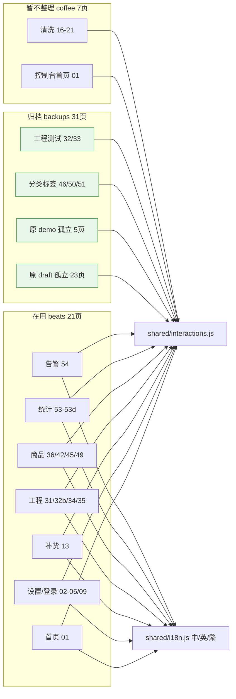

# 交互层审计与统一方案

> 目标：把整套平台做成可交互（含键盘输入等），用**一个统一的交互层**覆盖所有页面。
> 本文为**审计记录 + 统一方案**：所列问题均已按 §4 方案实施完毕，各项「状态」标明解决情况与对应提交。
> 权威代码：`/Users/qian2/Downloads/ui-prototype`

---

## 1. 现状一句话总结

审计时全站 51 页中仅 23 页接入声明式交互引擎 `shared/interactions.js`（靠 HTML 的 `data-*` 属性驱动，无需每页写 JS），其余 28 页无交互层，且引擎缺标签页、输入、下拉等能力。

**当前（2026-10-21）：全站 59/59 页接入引擎，问题清单全部关闭**，并追加了浮层化弹窗范式、全站三语、统计模块、目录三分类重组四项能力。

**当前规模**：`beats/` 21 页（在用）+ `backups/` 31 页（归档）+ `coffee/` 7 页（暂不整理）= 59 页（+ 导航页 `index.html`）；交互钩子约 **1380** 处；在用 `beats/` 21 页 **69 条跳转 0 死链**；**857 条**中英词条 + 繁体（`S2T_PHRASE` 24 条 / `S2T_CHAR` 195 字）。

---

## 2. 问题清单与解决状态（按严重程度）

### 🔴 P0 · 覆盖缺口：28 页完全没有交互层 — ✅ **已解决**
审计时仅 23 页引入 `<script src="../shared/interactions.js" defer>`：`01, 13, 15, 15b, 15c, 16(vm), 17(vm), 18(vm), 19(vm), 20(vm), 21(vm), 22(vm), 36, 42, 43, 44, 45, 46, 47, 48, 49, 50, 51`。

其余 28 页（demo 01–10、咖啡机补货 11/12/12b/14、清洗 16–21、校准 23/24/24b、工程模式 31–35）为静态截图态。

> **现状**：阶段 1 批量注入后全部接入，现**59/59 页**（含后续新增统计 5 页、告警 1 页）。各页统一用 `../shared/` 相对路径，加脚本时无需改路径。

### 🔴 P0 · 死键盘（`14-ops-restock-numpad.html`）— ✅ **已解决**
该页有 16 个 `np-key` + 2 个 `np-display`，但整页无 `<script>`，键盘点不动。

> **现状**：注入引擎后复活；现已并入 `11-ops-overview` 的浮层，键盘仍可用。

### 🟠 P1 · 引擎不支持标签页切换 — ✅ **已解决**
6 个 Demo 页（`02, 03, 06, 07, 08, 09`）用 `.vs-tabs` / `.vs-tab` 做页内分页，引擎无 tab 逻辑。

> **现状**：引擎已自动接管 `.vs-tab`（互斥高亮 + 面板显隐）；Demo 三 tab 按位跳 02/09/03。

### 🟠 P1 · 整站没有真实表单输入控件 — ✅ **已解决（按决策走屏上键盘）**
审计时全站**无** `<input>` / `<select>` / `range` / checkbox / radio。

> **现状**：决策为「全部用屏上数字键盘」→ 引擎提供通用 `data-kb` 键盘（`data-kb-mask` 掩码 / `data-kb-max` 位数 / `data-kb-ph` 占位 / `data-kb-toast`+`data-kb-goto` 确定后行为），登录账号密码、口令（6 位掩码）、补货量、价格、杯数、时长、称量值、水量全部接入。仍不使用原生 `<input>`。

### 🟡 P2 · 零散内联 JS（47/48/49）— ✅ **已解决**
三页各有读取 `sessionStorage.vs-ctx` 设动态标题的内联脚本。

> **现状**：逻辑并入引擎初始化，改由 `.vs-section-title[data-ctx]` + `data-ctx-noun/fixed/fallback` 驱动，三页内联脚本已删除，全站实现「只靠 data 属性」。

### 🟡 P2 · `data-close-hide` 从未被使用 — ✅ **已解决并成为主流范式**
审计时全站 0 处使用；弹窗一律「整页即弹窗 + `data-close-go` 跳回」。

> **现状**：2026-10-16 升级为**父页面内浮层**（无遮罩）后，`data-modal` / `data-close-hide` / `data-close-all` / `data-modal-stack` / `data-modal-safe` 成为弹窗主流；约 19 个弹窗页并入 8 个父页，`data-close-go` 仅保留给深链截图态页。

### 🟢 P3 · 无重复脚本 / 路径错乱 — ✅ 保持
每页仅 1 份引擎引用，路径前缀统一 `../shared/`。

---

## 3. 引擎能力清单（审计建议 vs 现状）

| 能力 | 审计时 | 现状 |
|---|---|---|
| 标签页切换 | 不支持 | ✅ 自动接管 `.vs-tab` |
| 文本输入 | 无 | ✅ 屏上数字键盘 `data-kb*`（决策：不使用原生 input） |
| 屏上键盘复用 | 仅 15c/44 生效，14 死 | ✅ 全站统一，14 已复活 |
| 开关 / 分段控件 | `data-toggle` 仅切类名 | ✅ `.vs-radio` 互斥语义（带 `data-href` 时为模式切换） |
| 下拉 / 选择 | 无 | ✅ `data-menu`（13 排序菜单 5 项、01-home 用户菜单） |
| 滑块 / 步进调节 | 仅 `data-step` | ✅ `data-step` 扩展至 `.pp-stepper`（参数页） |
| 动态标题（vs-ctx） | 47/48/49 各自内联 | ✅ 并入引擎 |
| **弹窗浮层**（后续新增） | 无 | ✅ `data-modal` / `-stack` / `-safe` / `data-close-hide` / `data-close-all` / `data-fill-lane` / `data-fill-name` |
| **测试出货流程**（后续新增） | 无 | ✅ `data-ship` / `-go` / `-stop` / `-done` / `-text` |
| **按货道出货**（后续新增） | 无 | ✅ 10 层 × 8 货道矩阵 + 「是否出货」二次确认（`backups/32` 模式 Tab） |
| **三语**（后续新增） | 无 | ✅ `data-act="set-lang"` + `shared/i18n.js`（**857 条**中英词条 + 繁体 `S2T_PHRASE`/`S2T_CHAR`，`localStorage` 键 `vs-lang`） |
| **通用二次确认**（后续新增） | 无 | ✅ `data-del` / `data-op="remove-tags"` + `VS.confirm`（含 %s 动态正文） |

---

## 4. 统一方案（三步走 · 全部执行完毕）

**第一步 · 全覆盖接入** — ✅ 已完成
28 个未接页统一注入 `shared/interactions.js`；后续统计模块 5 页、告警 1 页同样接入，现 59/59。

**第二步 · 引擎扩容** — ✅ 已完成
tab 切换、屏上键盘规范（修好 14）、`vs-ctx` 动态标题并入引擎并删除 47/48/49 内联脚本；后续又补浮层栈、下拉菜单、出货流程、三语切换、通用二次确认。

**第三步 · 静态页补交互标记** — ✅ 已完成
登录、设置、校准、工程参数等录入型页面按统一规范补 `data-*` 标记，屏幕键盘统一为 `.np-key` / `.np-display`（现升级为 `data-kb` 通用键盘）。

> 架构结论：**沿用声明式 `data-*` 引擎路线**（契合"不要动原来文件 / 去代码化"要求），未引入 React/Vue 等重型框架。

---

## 5. 决策点结论

| 决策点 | 结论 |
|---|---|
| 输入控件标准 | 统一用**屏上 numpad/键盘**（全部纯数字，不使用原生 `<input>`）；账号按纯数字处理，未引入字母键盘变体 |
| 弹窗范式 | 初定「整页即弹窗 + `data-close-go`」→ **2026-10-16 变更为「父页面内浮层」（V2）**：无遮罩轻浮层 + 浮层栈 + 安全级（`data-modal-safe`）；`data-close-go` 仅留给深链页 |
| 弹窗版式（追加） | **2026-10-18 统一三段式**：`.vs-modal-head` + `.vs-modal-body` + `.md-foot`；`shared` 的 `.vs-modal` 本身无内边距，页面需走三段式或页级覆盖 |
| 多语言（追加） | 全站**中 / 英 / 繁**三语，`shared/i18n.js` 走查式替换，页面零标记；入口在 02 设置页语言行与 01-home 用户菜单；繁体由 `S2T_PHRASE`（24 条词组）+ `S2T_CHAR`（195 字）派生，与 OpenCC `s2tw` 基准 **442/442 一致** |
| 目录结构（追加） | **2026-10-19 重组为三目录**：`beats/`（21 页在用）/ `backups/`（31 页归档）/ `coffee/`（7 页暂不整理）；`draft/` 与 `demo/` 已删除；全站统一首页 `beats/01-beats-home.html` |

---

## 6. 追加审计（后续新增工作）

| 日期 | 事项 | 提交 |
|---|---|---|
| 2026-10-15 | 首页更多功能接线「基本设置 / 账号设置」 | `a81580d` |
| 2026-10-16 | 弹窗范式升级 V2（浮层化） | `fb9e45f` / `32268ab` |
| 2026-10-16 | 全站中英双语 | `d69f882` |
| 2026-10-17 | 目录调整 `coffee/` + 首页统一 | `e6851eb` |
| 2026-10-17 | 统计模块 5 页（Figma 原型还原） | `74a5854` |
| 2026-10-17 | 告警模块落地（`beats/54-alerts.html` + 首页双入口 + `?tab` 预选） | — |
| 2026-10-18 | 弹窗三段式版式统一（`.vs-modal-head` / `.vs-modal-body` / `.md-foot`） | `6135141` / `8401375` |
| 2026-10-19 | 目录三分类重组（`beats/` / `backups/` / `coffee/`），46/50 分类标签退役 | `bc3f8c6` / `ce53a895` |
| 2026-10-19 | 测试出货新增「按货道出货」模式（10×8 矩阵 + 二次确认） | `bc3f8c6` / `25443d3` |
| 2026-10-21 | 31 改名「高级IoT设置」并移入首页快捷操作；单动测试 → `backups/33` | `d88e221` / `548bd11b` |
| 2026-10-21 | 修复 `backups/33`「出料电机 1·停止」误跳 `backups/32` | `0090e7b` / `2a3dfad` |
| 2026-10-21 | 三语完善：beats 业务 EN 覆盖 0 缺失（857 条）+ 繁体补 8 字与 OpenCC 一致 + 4 份文档同步 | 本次提交 |

**仍开放的事项（未实施）**

1. **商品分类 / 标签业务**：46（商品分类管理）、50（标签管理）及其子页 47/48/51 已随目录重组移入 `backups/`，入口已从首页与 `beats/36-products.html` 移除。后续若恢复该业务，需重新接线并同步 §2 目录表。
2. 首页更多功能 `预留5`：仍为占位，未接线。
3. `coffee/` 7 页本轮**明确不整理**（用户决策），其内仍残留指向已删除 `draft/` 的陈旧链接 16 处。
4. `backups/23-calibration` 的「研磨粉校准」hero 区未接线：页面上的 → 箭头无跳转，`24-calibration-grind` 目前只能从导航页进入（补一个 `data-href="24-calibration-grind.html"` 即可）。该页整组已归档，不优先处理。

---

_审计基于全站 HTML 的静态扫描（script 引用、内联 JS、键盘/输入控件、`data-*` 指令）与运行时回归（jsdom + 无头 Chrome）；本文为审计与方案记录，方案已全部落地。_
