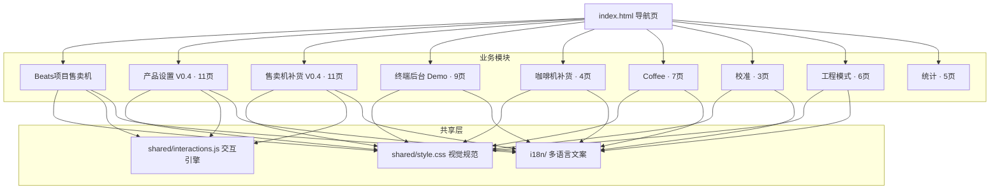
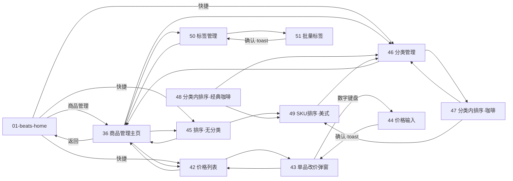
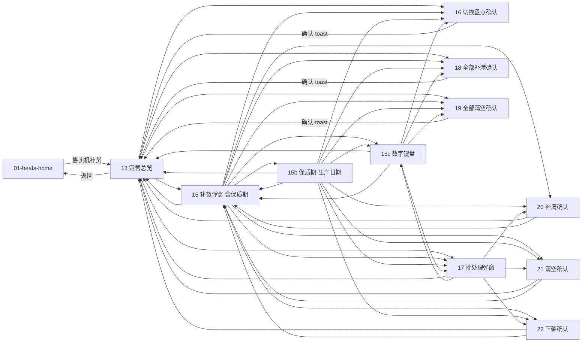
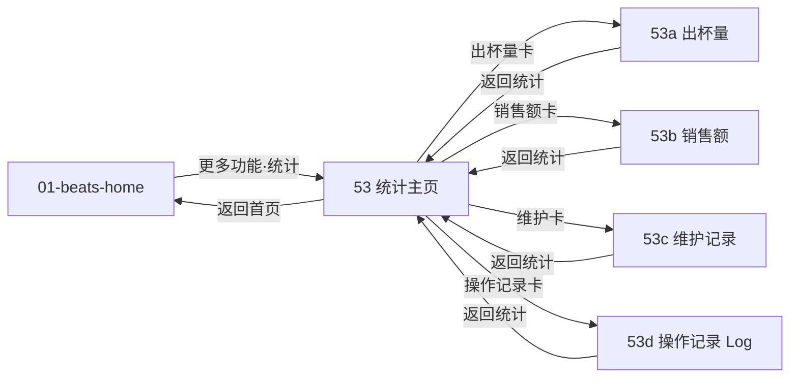

# VendSolution 终端后台 UI 原型 · 页面逻辑与架构

> 面向研发的页面逻辑关系与架构说明（纯静态原型，无后端）。
> 配套权威代码目录：`/Users/qian2/Downloads/ui-prototype`
> 关联文档：`角色权限矩阵.md`（权限边界）、`index.html`（导航页）

---

## 1. 总览

| 项 | 说明 |
|---|---|
| 项目定位 | 售卖机（Beats 项目）终端后台操作原型，工业风（黑白灰、1px 边框、6px 圆角、无渐变） |
| 技术形态 | 纯静态 HTML + 共享 CSS + 声明式 JS 交互引擎，无构建、无后端 |
| 入口 | `index.html` —— 按 9 大模块分组的可视化导航页 |
| 统一首页 | `draft/01-beats-home.html` —— 全站唯一首页（各页「返回首页」、登录成功均落地于此；原 `demo/01-home.html` 已移入 `coffee/`） |
| 页面规模 | `draft/` 41 页 + `demo/` 9 页 + `coffee/` 7 页 = 57 页（另有导航页 `index.html`） |
| 共享层 | `shared/style.css`（统一视觉）、`shared/interactions.js`（交互引擎）、`shared/fonts/` |
| 多语言 | `i18n/`（`VendSolution_终端后台_多语言文案表.xlsx`、校准文案 `i18n-calibration.md`） |
| 已接线交互 | 23 个页面已通过交互引擎完成跳转闭环（见 §6） |

### 架构分层（Mermaid）

---

## 2. 模块分组清单（9 组）

来源于 `index.html` 的 `GROUPS` 定义，是页面组织的权威划分。

| # | 分组 | 目录 | 标签 | 页数 | 页面编号 |
|---|---|---|---|---|---|
| 1 | Beats项目售卖机 | `draft/` | — | 1 | 01 |
| 2 | 产品设置 V0.4 | `draft/` | 新 | 11 | 36, 42, 43, 44, 45, 46, 47, 48, 49, 50, 51 |
| 3 | 售卖机补货 V0.4 | `draft/` | 新 | 11 | 13, 15, 15b, 15c, 16, 17, 18, 19, 20, 21, 22 |
| 4 | 终端后台 Demo | `demo/` | — | 9 | 02–10 |
| 5 | 咖啡机补货 | `draft/` | — | 4 | 11, 12, 12b, 14 |
| 6 | Coffee | `coffee/` | — | 7 | 01, 16, 17, 18, 19, 20, 21 |
| 7 | 校准 | `draft/` | — | 3 | 23, 24, 24b |
| 8 | 工程模式 | `draft/` | — | 6 | 31, 32, 32b, 33, 34, 35 |
| 9 | 统计 | `draft/` | — | 5 | 53, 53a, 53b, 53c, 53d |

> 注：`draft/` 中存在同名编号复用的两组页面（如 16/17/18/19/20/21 既属于「清洗」也属于「售卖机补货 V0.4」），靠文件名前缀区分（`*-cleaning-*` vs `*-vm-*`）。分组是**逻辑归类**，文件名是**唯一标识**。

---

## 3. 两大核心业务流（V0.4）

本次重点接线的是「产品设置 V0.4」与「售卖机补货 V0.4」两条业务流，二者均从 **01-beats-home（Beats 控制台首页）** 进入。

### 3.1 产品设置 V0.4（商品/价格/排序/标签）

入口：01 首页 → 36 商品管理主页。整条流以 **36 为中枢**，向价格、排序、标签三个子树发散，子页再回流到 36 或同子树内递进。

**页面职责**

| 页 | 职责 | 主要去向 |
|---|---|---|
| 36 | 商品管理主页（中枢） | 01 / 42 / 45 / 46 / 50 |
| 42 | 价格管理列表 | 36 / 43 |
| 43 | 单品改价弹窗 | 42 / 43（自闭环）/ 44 |
| 44 | 价格数字键盘输入 | 43（确认后 toast 返回） |
| 45 | 商品排序（无分类） | 36 / 49 |
| 46 | 分类管理·排序（中枢） | 36 / 47 |
| 47 | 分类内排序·咖啡 | 46 / 49 |
| 48 | 分类内排序·经典咖啡 | 46 / 49 |
| 49 | SKU 排序·美式（叶子） | 46 |
| 50 | 标签管理 | 36 / 51 |
| 51 | 批量管理 SKU 标签 | 50（确认后 toast 返回） |

### 3.2 售卖机补货 V0.4（运营总览 / 补货 / 盘点 / 二次确认）

入口：01 首页 → 13 售卖机运营总览。**13 为总览中枢**，**15 为补货弹窗中枢**（含保质期、数字键盘、批处理、二次确认的全集）。15b/15c 是 15 的变体（保质期按生产日期、数字键盘态），二者与 15 互相可达。

**页面职责与配色语义**

| 页 | 职责 | 确认语义色 | 主要去向 |
|---|---|---|---|
| 13 | 运营总览（中枢） | — | 01 / 15 / 16 / 17 / 18 / 19 |
| 15 | 补货弹窗（全集中枢） | — | 13 / 15b / 15c / 16–22 |
| 15b | 补货弹窗·保质期按生产日期 | — | 回 13 / 15 / 15c 及各确认页 |
| 15c | 补货数字键盘态 | — | 回 13 / 15 / 各确认页 |
| 16 | 切换盘点模式确认 | — | 13（确认 toast 返回） |
| 17 | 批处理弹窗（多选补货） | — | 13 / 15c / 20 / 21 / 22 |
| 18 | 二次确认·全部补满 | 绿 | 13（确认 toast 返回） |
| 19 | 二次确认·全部清空 | 橙 | 13（确认 toast 返回） |
| 20 | 二次确认·补满 | 绿 | 13 / 15 |
| 21 | 二次确认·清空 | 橙 | 13 / 15 |
| 22 | 二次确认·下架 | 粉 | 13 / 15 |

> 配色语义来自文件名后缀约定：`fill`=绿（补满）、`clear`=橙（清空）、`remove`=粉（下架）、`fill-all`=绿、`clear-all`=橙。

### 3.3 统计（2026-10-17 新增，来源 Figma「安卓终端后台2.0」）

入口：01-beats-home 更多功能「**统计**」（原预留3）→ **53 统计主页**（时间范围段 + 2×2 指标卡）→ 四个详情页。详情页左上角「← 返回统计」回 53，53 左上角「← 返回首页」回 01。

| 页 | 内容 | 页内交互 |
|---|---|---|
| 53 | 时间范围（今日/本周/本月/自定义）+ 四卡：出杯量 128 杯、销售额 ¥1,280、维护、操作记录 Log（各带最近一次时间与查看入口） | 时间范围段互斥选中 |
| 53a | 出杯量趋势（步进折线，08:00–18:00）+ SKU 出杯量表 | 最多/最少排序切换 |
| 53b | 销售额趋势 + SKU 销售额表（**Figma 未提供该帧，按 53a 同构补齐**，SKU 金额合计与首页卡片一致） | 最多/最少排序切换 |
| 53c | 维护记录表（日期/操作/操作人）+ 维护次数 | — |
| 53d | 操作记录 Log 表（时间/操作/操作人，30 条模拟数据） | 操作类型筛选 + 每页 6 条分页（1/5，上/下页） |

---

## 4. 其余模块（占位 / 待接线）

以下分组在 `index.html` 中已归档，但本轮未做交互接线（页面以静态截图态为主）：

- **终端后台 Demo**（`demo/02–10`）：登录、本机设置、用户权限、设备信息、关机弹窗等完整闭环 Demo；「返回首页」与登录成功统一落到 `draft/01-beats-home.html`。
- **咖啡机补货**（`11/12/12b/14`）：与「售卖机补货 V0.4」同构的旧版（咖啡机视角），作为对照参考。
- **Coffee**（`coffee/`）：01 控制台首页（原 demo 首页迁入）+ 清洗系列 16–21（`*-cleaning-*`）：清洗主页 → 三种清洗策略 → 整机清洗确认/进行中。
- **校准**（`23/24/24b`）：校准主页 → 研磨量校准 / 水料水量校准。
- **工程模式**（`31–35`，含 32b）：高级设置 → 单动测试（含运行中）→ 传感器状态 → 参数调节。

---

## 5. 交互引擎（shared/interactions.js）

页面**不写重复 JS**，仅通过 HTML 属性声明行为，由全局点击委托统一接管。这是整套原型「去代码化」的关键层。

| 指令 / 能力 | 形式 | 行为 |
|---|---|---|
| 页面跳转 | `data-href="x.html"` | 点击跳转；若元素含 `.pm-sort-name/.pm-cat-name` 则记录来源上下文供排序页动态标题 |
| 跳转并提示 | `data-act="goto-toast"` + `data-href` + `data-toast` | 跳转后落地页自动弹出 toast（通过 `sessionStorage` 桥接） |
| 关闭弹窗·留本页 | `data-close-hide` | 隐藏当前 `.vs-overlay`（用于列表页上浮的弹窗） |
| 关闭弹窗·回来源 | `data-close-go="x.html"` | 整页即弹窗态页面关闭 = 返回来源页 |
| 提示 | `data-toast="文案"` | 点击弹底部 toast（1.8s 自动消失） |
| 状态切换 | `data-toggle="active"` | 切换自身类名 |
| 步进器 | `data-step="+"/"-"` | `.stepper` 内数值 +1/-1，下限 0 |
| 货道加减 | `.vm-ctrl .sq`（自动接管） | 货道卡片 `+N` 计数 |
| 数字键盘 | `.np-key`（自动接管） | `.np-display` 输入：数字、小数点、负号、退格 |
| SKU 勾选 | `.pm-sku`（自动接管） | 切换选中态并显示 ✓ |
| 标签切换 | `.pm-chip`（自动接管） | 切换选中态 |
| 分类删除 | `data-del`（自动接管） | 隐藏所在 `.pm-cat-row` 并 toast |
| 标签批量操作 | `data-op="remove-tags\|clear-sel"` | 移除所选 SKU 标签 / 清除全部选择 |
| 拖拽排序 | `.pm-sort-list .pm-sort-card`（自动接管） | HTML5 拖拽重排，自动重编号 `L1/L2…` |
| 点遮罩关闭 | `.vs-overlay`（自动接管） | 点击遮罩层关闭其内弹窗 |

**跨页上下文机制**：`sessionStorage` 两项桥接——`vs-pending-toast`（落地页弹提示）、`vs-ctx`（排序/分类来源名称与数量，用于动态标题）。

---

## 6. 已接线页面跳转关系全表（28 页）

下列为已通过交互引擎完成闭环的页面及其出向跳转（来源：`draft/` 各页的 `href`/`data-href`/`data-close-go`/`data-act` 静态提取）。

| 页面 | 出向跳转目标 | 交互动作 |
|---|---|---|
| 01-beats-home | 13, 36, 42, 45, 46 | — |
| 13-vm-ops-overview | 01, 15, 16, 17, 18, 19 | — |
| 15-vm-ops-restock-modal | 13, 15b, 15c, 16, 17, 18, 19, 20, 21, 22 | goto-toast |
| 15b-vm-ops-restock-shelflife-date | 13, 15, 15c, 16, 17, 18, 19, 20, 21, 22 | goto-toast |
| 15c-vm-ops-restock-numpad | 13, 15, 16, 17, 18, 19 | goto-toast |
| 16-vm-switch-inventory-confirm | 13 | goto-toast |
| 17-vm-batch-restock-modal | 13, 15c, 20, 21, 22 | goto-toast |
| 18-vm-confirm-fill-all | 13 | goto-toast |
| 19-vm-confirm-clear-all | 13 | goto-toast |
| 20-vm-confirm-fill | 13, 15 | goto-toast |
| 21-vm-confirm-clear | 13, 15 | goto-toast |
| 22-vm-confirm-remove | 13, 15 | goto-toast |
| 36-products | 01, 42, 45, 46, 50 | — |
| 42-products-price-1 | 36, 43 | — |
| 43-products-price-2 | 42, 43, 44 | — |
| 44-products-price-3 | 43 | goto-toast |
| 45-products-sort-1 | 36, 49 | — |
| 46-products-sort-2 | 36, 47 | — |
| 47-products-sort-3 | 46, 49 | — |
| 48-products-sort-4 | 46, 49 | — |
| 49-products-sort-5 | 46 | — |
| 50-products-category-1 | 36, 51 | — |
| 51-products-category-2 | 50 | goto-toast |
| 53-stats | 01, 53a, 53b, 53c, 53d | — |
| 53a-stats-cups | 53 | — |
| 53b-stats-sales | 53 | — |
| 53c-stats-maintenance | 53 | — |
| 53d-stats-log | 53 | — |

> 未在上述表中出现的 `draft/` 页面（`11/12/12b/14` 咖啡机补货、`16–21` cleaning 系列、`23/24/24b` 校准、`31–35` 工程模式）本轮**未接线**，以静态展示为主。

---

## 7. 共享视觉规范（shared/style.css）

全站统一视觉由 `style.css` 提供，关键约定：

- 画布：`.vs-canvas` 固定 1280×1280（部分竖屏页如 36 已派生 1080×1920 版本），flex 列布局 + `overflow:hidden`。
- 组件类：`.vs-topbar`（顶栏）、`.vs-tabs`（选项卡）、`.vs-section-title`（区块标题）、`.mono`（等宽数字）、`.vs-btn-line`（线框按钮）、`.vs-quick-btn` / `.vs-more-btn`（快捷/更多）、`.pm-*`（产品管理系列：`.pm-sku`/`.pm-chip`/`.pm-sort-list`/`.pm-cat-row` 等）。
- 设计基调：工业风，1px 边框、6px 圆角、无渐变、黑白灰 + 单一强调色（橙）。

---

## 8. 权限边界（引用 角色权限矩阵.md）

页面级权限以独立的 `角色权限矩阵.md` 为准（店长 / 店员 / 维修三类角色 × 全页）。本原型接线时的关键约定：

- **售卖机补货 V0.4（13–22）**、**产品设置 V0.4（36–51）**：属运营敏感操作，默认仅**店长**可见/可操作。
- 早期统计类页面（27/30）仅店长可见；**47–51（分类内排序 / SKU 排序 / 标签管理）** 店员亦可操作（历史约定，详见权限矩阵文档）。
- 维修角色聚焦设备层（校准 23/24/24b、工程模式 31–35）。

> 研发接入真实权限时，建议结合 `角色权限矩阵.md` 在导航层（`index.html` 的 `GROUPS`）与路由层做角色过滤，原型当前未做前端权限拦截。

---

## 9. 弹窗范式：页面内浮层（2026-10-16 升级）

全站弹窗由「整页即弹窗」（每个弹窗一个独立页，跳转进入）升级为**页面内浮层**：浮层挂在父页面内，点触发器直接浮出，不再跳页。

**范式约定**（`shared/interactions.js` + `shared/style.css`）：

- **无遮罩轻浮层**：`.vs-overlay` 为透明全页点击捕获层，`.vs-modal` 为居中投影浮卡（`box-shadow` + 淡入动画），背后页面内容原样可见、不变暗。
- **指令**：`data-modal="#id"` 打开（默认互斥）；`data-modal-stack` 堆叠打开（链式弹窗，引擎逐层抬高 z-index）；`data-close-hide` 收起最上层；`data-close-all` 收拢整个浮层栈（终态确认）；`data-close-go` 仅保留给深链接截图态页。
- **安全级**：`.vs-overlay[data-modal-safe]`（加载中/完成态）点浮层空白处即收起；默认（确认/表单/输入）为危险操作，只能通过按钮关闭。
- **动态回填**：`data-fill-lane` / `data-fill-name` 按触发卡片的货道号/商品名回填浮层标题（如点 L1 卡开补货浮层，标题显示「L1 · 咖啡豆」）。

**已合并的弹窗**（源页保留为深链/截图态，`index.html` 中标注「深链」）：

| 父页（浮层入口） | 并入的浮层（源页） |
|---|---|
| 11-ops-overview（运营总览） | 12 补货弹窗、12b 保质期按生产日期、14 补货数字键盘 |
| 13-vm-ops-overview（售卖机运营总览） | 15 补货弹窗、15b、15c 数字键盘、16 切换盘点确认、17 批处理、18 全部补满、19 全部清空、20 补满、21 清空、22 下架 |
| coffee/16-cleaning（清洗） | 17 策略·只提醒、18 策略·按杯数、19 策略·按定时、20 整机清洗确认、21 清洗进行中 |
| demo/03-settings-users | 06 修改口令 |
| demo/09-device-info | 07 网络测试中、08 检查更新中 |
| coffee/01-home | 10 关机确认、08 检查更新中 |
| 42-products-price-1 | 43 修改价格、44 价格数字键盘 |
| 50-products-category-1 | 51 批量管理 SKU 标签 |

**典型链路**：补货浮层 →（按生产日期）堆叠保质期浮层 →（点补货量）堆叠数字键盘浮层 → 确定收拢全部，回到父页；危险确认（清空/下架/关机）堆叠在补货浮层之上，确认后 `data-close-all` 一并收拢。

---

## 10. 本地预览与部署

- 本地预览：以静态服务器打开 `index.html` 即可（曾用 `127.0.0.1:8901`）。
- 在线部署：Railway 域名 `https://iot-android-mgmt.up.railway.app`（关联仓库 `github.com/nicozhan/iot-android-screen`，原 `ui-prototype` 已改名）。
- 代码仓库：`github.com/nicozhan/iot-android-screen`（私有）。

---

_文档由页面静态结构（`href`/`data-*` 指令）与 `index.html` 分组定义自动梳理；第 9 节为浮层化改造记录。_
