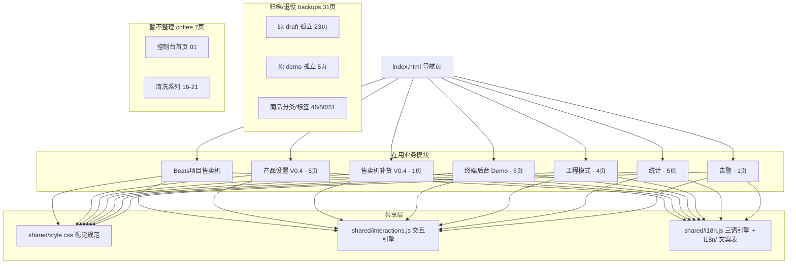
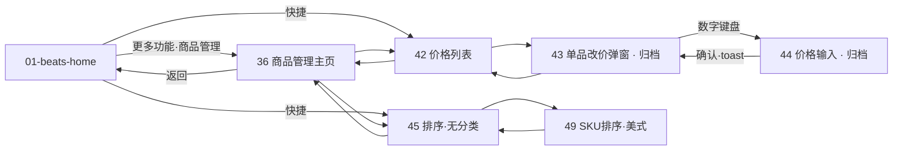
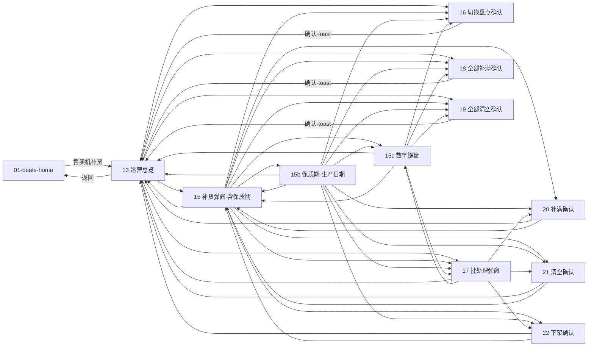
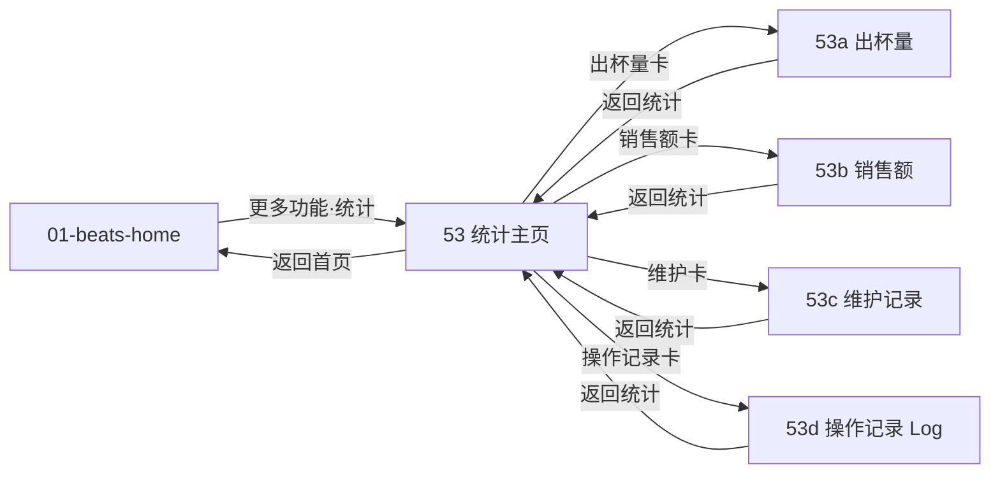
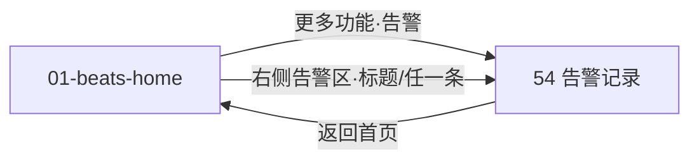
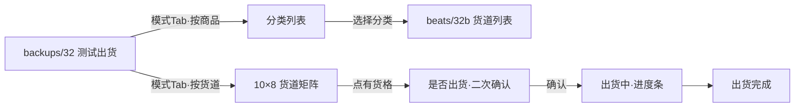

# VendSolution 终端后台 UI 原型 · 页面逻辑与架构

> 面向研发的页面逻辑关系与架构说明（纯静态原型，无后端）。
> 配套权威代码目录：`/Users/qian2/Downloads/ui-prototype`
> 关联文档：`角色权限矩阵.md`（权限边界）、`index.html`（导航页）

---

## 1. 总览

| 项 | 说明 |
|---|---|
| 项目定位 | 售卖机（Beats 项目）终端后台操作原型，工业风（黑白灰、1px 边框、6px 圆角、无渐变） |
| 技术形态 | 纯静态 HTML + 共享 CSS + 声明式 JS 交互引擎，无构建、无后端 |
| 入口 | `index.html` —— 按 10 大模块分组的可视化导航页（脚本按文件名自动判定目标目录：`BEATS` 集合 → `beats/`，`COFFEE` 集合 → `coffee/`，其余 → `backups/`） |
| 统一首页 | `beats/01-beats-home.html` —— 全站唯一首页（各页「返回首页」、登录成功均落地于此；原 `demo/01-home.html` 移入 `coffee/`） |
| 页面规模 | `beats/` 21 页（**在用**）+ `backups/` 31 页（归档/退役）+ `coffee/` 7 页 = 59 页（另有导航页 `index.html`） |
| 共享层 | `shared/style.css`（统一视觉）、`shared/interactions.js`（交互引擎）、`shared/i18n.js`（三语引擎）、`shared/fonts/` |
| 多语言 | `shared/i18n.js` 运行时翻译引擎（**857 条中英词典** + `S2T_PHRASE` 24 条词组 / `S2T_CHAR` 195 字逐字表派生**繁体中文**；`localStorage` 键 `vs-lang` 持久化，全站 HTML 接入）；另 `i18n/` 存 `VendSolution_终端后台_多语言文案表.xlsx` 与校准文案 `i18n-calibration.md` |
| 已接线交互 | **全站 59/59 页接入 `shared/interactions.js`**；在用 `beats/` 21 页 **69 条跳转 0 死链**；弹窗统一走页面内浮层（§9） |

### 架构分层（Mermaid）

---

## 2. 模块分组清单（10 组）

来源于 `index.html` 的 `GROUPS` 定义，是页面组织的权威划分。**目录以 `beats/`（在用）/ `backups/`（归档）/ `coffee/`（暂不整理）三分为准**；`index.html` 渲染时按文件名自动判定目标目录（`BEATS` / `COFFEE` 两个 Set，其余落 `backups/`）。

| # | 分组 | 目录 | 标签 | 页数 | 页面编号 |
|---|---|---|---|---|---|
| 1 | Beats项目售卖机 | `beats/` | — | 1 | 01 |
| 2 | 产品设置 V0.4 | `beats/` + `backups/` | 新 | 11 | 36, 42, 43, 44, 45, 46, 47, 48, 49, 50, 51 |
| 3 | 售卖机补货 V0.4 | `beats/` + `backups/` | 新 | 11 | 13, 15, 15b, 15c, 16, 17, 18, 19, 20, 21, 22 |
| 4 | 终端后台 Demo | `beats/` + `backups/` | — | 10 | 02–10 |
| 5 | 咖啡机补货 | `backups/` | — | 4 | 11, 12, 12b, 14 |
| 6 | Coffee | `coffee/` | — | 7 | 01, 16, 17, 18, 19, 20, 21 |
| 7 | 校准 | `backups/` | — | 3 | 23, 24, 24b |
| 8 | 工程模式 | `beats/` + `backups/` | — | 6 | 31, 32, 32b, 33, 34, 35 |
| 9 | 统计 | `beats/` | — | 5 | 53, 53a, 53b, 53c, 53d |
| 10 | 告警 | `beats/` | — | 1 | 54 |

### 2.1 目录三分类（2026-10-19 重组）

| 目录 | 页数 | 定位 | 内容 |
|---|---|---|---|
| `beats/` | 21 | **在用** | 首页 01、设置/登录 02/03/04/05/09、补货 13、工程 31/32b/34/35、商品 36/42/45/49、统计 53–53d、告警 54 |
| `backups/` | 31 | **归档 / 退役** | 原 `draft/` 孤立 23 页 + 原 `demo/` 孤立 5 页（02b/06/07/08/10）+ 商品分类/标签 46/50/51 + 工程测试 32/33 |
| `coffee/` | 7 | **暂不整理** | 控制台首页 01 + 清洗系列 16–21（用户明确要求本轮不整理） |

> 重组后 `draft/` 与 `demo/` 目录已删除，页面通过 `git mv` 迁移以保留历史。
> **退役并从首页移除的入口**：商品分类管理（46）、标签管理（50）——「商品管理」卡片已从 `beats/36-products.html` 移除。
> **在用页链接校验**：`beats/` 21 页共 **69 条跳转（含 `<a href>`）0 死链**。`backups/` 与 `coffee/` 内仍残留指向已删除 `draft/` 的陈旧链接（22 处），属归档快照与未整理页，不影响在用流程。

> 注：编号 16–21 在两处出现——`draft/` 的售卖机补货 V0.4（`*-vm-*`）与 `coffee/` 的清洗系列（`*-cleaning-*`），靠**目录 + 文件名前缀**区分。分组是**逻辑归类**，目录 + 文件名是**唯一标识**。

---

## 3. 两大核心业务流（V0.4）

本次重点接线的是「产品设置 V0.4」与「售卖机补货 V0.4」两条业务流，二者均从 **01-beats-home（Beats 控制台首页）** 进入。

### 3.1 产品设置 V0.4（商品 / 价格 / 排序）

入口：01 首页「更多功能 → 商品管理」→ 36 商品管理主页。整条流以 **36 为中枢**，向价格、排序两个子树发散，子页再回流到 36。

> **2026-10-19 调整**：商品分类管理（46）与标签管理（50）整组移入 `backups/` 并从 36 的菜单中移除（分类/标签相关业务本轮不整理）。46/50/51 及其子页 47/48 保留为归档深链。

**页面职责**

| 页 | 目录 | 职责 | 主要去向 |
|---|---|---|---|
| 36 | `beats/` | 商品管理主页（中枢） | 01 / 42 / 45 |
| 42 | `beats/` | 价格管理列表 | 36 / 43（归档） |
| 43 | `backups/` | 单品改价弹窗（归档） | 42 / 43 / 44 |
| 44 | `backups/` | 价格数字键盘输入（归档） | 43 |
| 45 | `beats/` | 商品排序（无分类） | 36 / 49 |
| 49 | `beats/` | SKU 排序·美式（叶子） | 45 |
| 46 | `backups/` | 商品分类管理（**已退役**，左分组筛选 + SKU 批量分组操作） | 36（归档） |
| 47 / 48 | `backups/` | 分类内排序·咖啡 / 经典咖啡（归档） | 50 / 49（归档） |
| 50 | `backups/` | 标签管理（**已退役**，左右 4:6：左标签导航筛选 + 右 SKU 批量标签操作） | 36 / 51（归档） |
| 51 | `backups/` | 批量管理 SKU 标签（归档深链） | 50 |

### 3.2 售卖机补货 V0.4（运营总览 / 补货 / 盘点 / 二次确认）

入口：01 首页 → 13 售卖机运营总览。**13 为总览中枢**，**15 为补货弹窗中枢**（含保质期、数字键盘、批处理、二次确认的全集）。15b/15c 是 15 的变体（保质期按生产日期、数字键盘态），二者与 15 互相可达。

**页面职责与配色语义**

| 页 | 职责 | 确认语义色 | 主要去向 |
|---|---|---|---|
| 13 | 运营总览（中枢） | — | 01 / 15 / 16 / 17 / 18 / 19 |
| 15 | 补货弹窗（全集中枢） | — | 13 / 15b / 15c / 16–22 |
| 15b | 补货弹窗·保质期按生产日期 | — | 回 13 / 15 / 15c 及各确认页 |
| 15c | 补货数字键盘态 | — | 回 13 / 15 / 各确认页 |
| 16 | 切换盘点模式确认 | — | 13（确认 toast 返回） |
| 17 | 批处理弹窗（多选补货） | — | 13 / 15c / 20 / 21 / 22 |
| 18 | 二次确认·全部补满 | 绿 | 13（确认 toast 返回） |
| 19 | 二次确认·全部清空 | 橙 | 13（确认 toast 返回） |
| 20 | 二次确认·补满 | 绿 | 13 / 15 |
| 21 | 二次确认·清空 | 橙 | 13 / 15 |
| 22 | 二次确认·下架 | 粉 | 13 / 15 |

> 配色语义来自文件名后缀约定：`fill`=绿（补满）、`clear`=橙（清空）、`remove`=粉（下架）、`fill-all`=绿、`clear-all`=橙。

### 3.3 统计（2026-10-17 新增，来源 Figma「安卓终端后台2.0」）

入口：01-beats-home 更多功能「**统计**」（原预留3）→ **53 统计主页**（时间范围段 + 2×2 指标卡）→ 四个详情页。详情页左上角「← 返回统计」回 53，53 左上角「← 返回首页」回 01。

| 页 | 内容 | 页内交互 |
|---|---|---|
| 53 | 时间范围（今日/本周/本月/自定义）+ 四卡：出杯量 128 杯、销售额 ¥1,280、维护、操作记录 Log（各带最近一次时间与查看入口） | 时间范围段互斥选中 |
| 53a | 出杯量趋势（步进折线，08:00–18:00）+ SKU 出杯量表 | 最多/最少排序切换 |
| 53b | 销售额趋势 + SKU 销售额表（**Figma 未提供该帧，按 53a 同构补齐**，SKU 金额合计与首页卡片一致） | 最多/最少排序切换 |
| 53c | 维护记录表（日期/操作/操作人）+ 维护次数 | — |
| 53d | 操作记录 Log 表（时间/操作/操作人，30 条模拟数据） | 操作类型筛选 + 每页 6 条分页（1/5，上/下页） |

### 3.4 告警（2026-10-17 设计 → 实施，页面 `beats/54-alerts.html`）

已按用户确认的 5 点落地为代码。

- **两个入口**（首页 `beats/01-beats-home.html`）：
  - 「更多功能」原 `预留2` 按钮改为**「告警」**，`href="54-alerts.html"`。
  - 右侧告警区 `.vs-alerts-head`（标题栏 + 数字徽章）及 3 条 `.vs-alert-item` 均带跳转，点任一条进入列表。
- **用户决策落地**：
  1. **说明列中英双语**：表格 `说明` 列显示中文翻译（主）+ 设备英文原文（次，muted mono），不随 UI 语言切换丢失英文。
  2. **首页进入按类型预选 tab**：告警行 URL 带 `?tab=ops`（纸杯余量不足、右搅拌器清洗提醒）或 `?tab=device`（离线）；落地页解析 `location.search` 自动激活对应 chip。
  3. **「告警 3」标题栏可点击**：`.vs-alerts-head` 整体带跳转，进入全部列表。
  4. **表格行无详情展开**：当前仅展示列表。
  5. **`coffee/01-home.html` 不同步**：旧首页未接入告警入口。
- **页面结构**：顶栏 + 左上「← 返回首页」；单选筛选条 **全部 / 设备类 / 运营类**（复用 `.pm-filter-bar` 单选逻辑）；表格四列 **时间 | 类型 | 告警代码 | 说明**；24 条模拟数据按时间倒序，**每页 10 行**，底部分页 `1 / N`。
- **两类告警样例**：
  - 设备类：`2026/10/01 23:23` · `Error_temp_over20` · `温度超过 20℃ / Temperature is over 20 °C`
  - 运营类：`2026/10/01 12:10` · `Slot1_1_low` · `Slot1-1 库存低于预警 20%（5/20） / Slot1-1 stock is less than alert 20% (5/20)`

---

## 4. 其余模块（均已接入交互引擎）

以下分组虽不是 §3 两条 V0.4 主业务流的重点，但同样**已接入交互引擎**（导航/浮层/键盘/toast 全部可点），并已统一到页面内浮层范式（§9）与三语（§1）：

- **终端后台 Demo**（`beats/02–05、09` + `backups/02b、06、07、08、10`）：登录（`04` 账号密码 / `05` 口令，口令 6 位掩码屏上键盘）→ 首页 → 本机设置 `02` / 用户权限 `03` / 设备信息 `09`；「返回首页」与登录成功统一落到 `beats/01-beats-home.html`；`06` 修改口令已并入 `03` 浮层，`07/08` 网络测试与检查更新已并入 `09` 浮层，`10` 关机确认已并入 `coffee/01-home` 浮层（`backups/02b、06、07、08、10` 为归档深链）。
- **Coffee**（`coffee/`）：`01` 控制台首页（原 `demo/01-home.html` 迁入）+ 清洗系列 `16–21`（`*-cleaning-*`）；`17–21` 已并入 `16` 的浮层，源页保留为深链截图态。**本轮不整理**。
- **咖啡机补货**（`backups/11/12/12b/14`）：与「售卖机补货 V0.4」同构的旧版（咖啡机视角），整组已归档，作为对照参考。
- **校准**（`backups/23/24/24b`）：`23` 校准主页 → `24b` 水量校准（共 5 个水量基准，接屏上键盘）；`24` 研磨粉校准（三次称量值接屏上键盘）—— 整组已归档，`23` 的「研磨粉校准」hero 区未接线。
- **工程模式**（`beats/31、32b、34、35` + `backups/32、33`）：
  - `beats/31` **高级IoT设置**（2026-10-21 由「高级设置」改名，并从首页「更多功能·预留4」移入**「快捷操作」网格**）→ 子页 `34` 传感器状态 / `35` 参数调节（步进器 + 保存）；「单动测试」→ `backups/33` 运行中页。
  - `backups/32` **测试出货**（按商品 / 按货道双模式，详见 §3.5）→ `beats/32b` 按分类的货道列表（内嵌出货流程浮层 `data-ship` → 出货中 → 完成）。
  - `backups/33` 单动测试·运行中：部件行可点「停止」（演示 toast），**不跳转**。

### 3.5 测试出货 · 按货道模式（2026-10-19 新增）

`backups/32-eng-unit-test.html` 在原有「按商品出货」分类列表之上，新增**按货道出货**模式：整机 **10 层 × 8 货道 = 80 格**按钮矩阵。

- **模式切换 Tab**：`按商品出货`（默认，原分类入口） / `按货道出货`（新增）。
- **矩阵状态**：有货（常态）/ 空（置灰，点按仅 toast）/ 故障（标红，点按仅 toast）。
- **二次确认**：点有货格 → 弹「**是否出货？**」浮层（回显货道号/状态/商品）→ 确认后直出（**无咖啡量/温度/糖配置**，货道直驱）。
- **复用引擎**：走 `data-ship` / `-go` / `-stop` / `-done` 流程，与 `32b` 视觉一致；确认前不含配置步骤。

---

## 5. 交互引擎（shared/interactions.js）

页面**不写重复 JS**，仅通过 HTML 属性声明行为，由全局点击委托统一接管。这是整套原型「去代码化」的关键层。

| 指令 / 能力 | 形式 | 行为 |
|---|---|---|
| 页面跳转 | `data-href="x.html"` | 点击跳转；若元素含 `.pm-sort-name/.pm-cat-name` 则记录来源上下文供排序页动态标题 |
| 跳转并提示 | `data-act="goto-toast"` + `data-href` + `data-toast` | 跳转后落地页自动弹出 toast（通过 `sessionStorage` 桥接） |
| 关闭弹窗·留本页 | `data-close-hide` | 隐藏当前 `.vs-overlay`（用于列表页上浮的弹窗） |
| 关闭弹窗·回来源 | `data-close-go="x.html"` | 整页即弹窗态页面关闭 = 返回来源页 |
| 提示 | `data-toast="文案"` | 点击弹底部 toast（1.8s 自动消失） |
| 状态切换 | `data-toggle="active"` | 切换自身类名 |
| 步进器 | `data-step="+"/"-"` | `.stepper` 内数值 +1/-1，下限 0 |
| 货道加减 | `.vm-ctrl .sq`（自动接管） | 货道卡片 `+N` 计数 |
| 数字键盘 | `.np-key`（自动接管） | `.np-display` 输入：数字、小数点、负号、退格 |
| SKU 勾选 | `.pm-sku`（自动接管） | 切换选中态并显示 ✓ |
| 标签切换 | `.pm-chip`（自动接管） | 切换选中态 |
| 分类删除 | `data-del`（自动接管） | 点击先弹二次确认框 `#vs-confirm-del`（危险浮层，空白不关），确认后才隐藏所在 `.pm-cat-row` 并 toast「已删除该分类」 |
| 标签批量操作 | `data-op="remove-tags\|clear-sel"` | 移除所选 SKU 的标签（46 页由页面脚本按数据层接管，改用“分组”措辞；50 页同样接管，用“标签”措辞；均含被筛掉的已选项）；文案可经 `data-op-title / data-op-text(可含 %s) / data-op-ok / data-op-done` 覆盖；`clear-sel` 清除全部选择 |
| 拖拽排序 | `.pm-sort-list .pm-sort-card`（自动接管） | HTML5 拖拽重排，自动重编号 `L1/L2…` |
| 打开浮层 | `data-modal="#id"`（+ `data-modal-stack` 堆叠） | 打开父页面内浮层（详见 §9） |
| 收起浮层 | `data-close-hide`（最上层）/ `data-close-all`（整个栈） | 收起浮层，停留在父页 |
| 安全级浮层 | `.vs-overlay[data-modal-safe]` | 点浮层空白处即可收起；未标注者为危险浮层，只能由按钮关闭 |
| 浮层回填 | `data-fill-lane` / `data-fill-name` | 按触发卡片的货道号 / 商品名回填浮层标题 |
| 下拉菜单 | `data-menu="#id"` | 打开排序菜单、用户菜单等自定义下拉（带 ✓ 选中态） |
| 屏上键盘 | `data-kb` + `data-kb-mask/max/ph/toast/goto` | 点输入框弹出全站统一数字键盘：口令掩码 ●、位数上限、占位还原、确定后提示或跳转 |
| 测试出货流程 | `data-ship` / `-go` / `-stop` / `-done` / `-text` | 出货确认 → 出货中（进度条约 2.5s）→ 完成浮层；文案按货道号/商品名回填 |
| 切换语言 | `data-act="set-lang"` + `data-lang="zh\|en\|zh-TW"` | 立即切换全站语言（**中文 / English / 繁體中文**）并写入 `localStorage.vs-lang`（须置于点击分发链最前） |
| 通用二次确认 | `data-del` / `data-op="remove-tags"` + `VS.confirm` | 引擎建壳 + 动态填充（标题/正文含 %s 占位/计数），OK 按钮执行回调；正文走 `T()` 可随语言切换重填 |

**跨页上下文机制**：`sessionStorage` 两项桥接——`vs-pending-toast`（落地页弹提示）、`vs-ctx`（排序/分类来源名称与数量，用于动态标题）。

---

## 6. 已接线页面跳转关系全表（在用 21 页）

下表列出 `beats/` **在用 21 页**的**出向跳转目标**（来源：各页 `href` / `data-href` / `data-close-go` 静态提取，共 **69 条跳转、0 死链**）。

> 归档页（`backups/` 31 页）与 `coffee/` 7 页的跳转不再逐一列表，仅在 §2.1 说明其状态（`backups/` 内存有指向已删除 `draft/` 的陈旧链接 22 处，属归档快照，不影响在用流程）。

### 6.1 统一首页 + 统计 + 告警（7 页）

| 页面 | 出向跳转目标 | 交互动作 |
|---|---|---|
| 01-beats-home（**全站统一首页**） | 13, 31, 36, 42, 45, 53, 54, `../backups/32`, 02（基本设置）, 03（账号设置）, 04（退出登录） | 快捷操作：补货 → 13 / 商品排序 → 45 / 商品价格 → 42 / 测试出货 → `../backups/32` / **高级IoT设置 → 31**；更多功能：基本设置 → 02、账号设置 → 03、商品管理 → 36、告警 → 54、统计 → 53、预留5（占位）；用户菜单：切换语言（中文 / English / 繁體中文）、返回售卖页面、退出登录（后两者二次确认后跳 04）；右侧告警区标题/任一条可进告警页（带 `?tab=` 预选） |
| 53-stats | 01, 53a, 53b, 53c, 53d | 时间范围段（今日/本周/本月/自定义）互斥选中 |
| 53a-stats-cups | 53 | 最多/最少排序切换 |
| 53b-stats-sales | 53 | 最多/最少排序切换 |
| 53c-stats-maintenance | 53 | — |
| 53d-stats-log | 53 | 操作类型筛选 + 分页（每页 6 条 / 共 5 页） |
| 54-alerts | 01 | 筛选条（全部/设备类/运营类）单选 + 分页（每页 10 行） |

> 首页更多功能区 `预留2` → **告警**（§3.4），`预留3` → **统计**（§3.3），`预留4` 原本接线「高级管理」→ 31，**2026-10-21 改为在「快捷操作」网格直接放「高级IoT设置」**，`预留5` 仍未接线。

### 6.2 产品设置（在用 4 页）

| 页面 | 出向跳转目标 | 交互动作 |
|---|---|---|
| 36-products | 01, 42, 45 | — （46/50 分类标签入口已移除） |
| 42-products-price-1 | 36 | 43/44 已并入本页浮层（源页在 `backups/`） |
| 45-products-sort-1 | 36, 49 | — |
| 49-products-sort-5 | 45 | （返回键 2026-10-19 由 46 改指 45） |

### 6.3 售卖机补货（在用 1 页）

| 页面 | 出向跳转目标 | 交互动作 |
|---|---|---|
| 13-vm-ops-overview | 01 | 排序下拉菜单（5 项：货道顺序/售卖顺序/库存少-多/SKU A-Z/SKU Z-A）；15–22 补货浮层全部并入本页浮层栈（源页在 `backups/`） |

### 6.4 终端后台 Demo（在用 5 页）

| 页面 | 出向跳转目标 | 交互动作 |
|---|---|---|
| 02-settings-device | 01, 03, 09 | 单位单选互斥；后台运维区含语言切换行（中文 / English / 繁體中文） |
| 03-settings-users | 01, 02, 09 | 06 修改口令已并入浮层 |
| 04-login | 01, 05 | 账号/密码接屏上键盘 |
| 05-login-passcode | 01, 04 | 口令 6 位掩码键盘 |
| 09-device-info | 01, 02, 03 | 07/08 已并入浮层 |

> 三个 tab（本机设置 / 设备信息 / 用户权限）按位跳 02/09/03；「返回首页」与登录成功统一落到 `beats/01-beats-home.html`。

### 6.5 工程模式（在用 4 页）

| 页面 | 出向跳转目标 | 交互动作 |
|---|---|---|
| 31-eng-settings（**高级IoT设置**） | 01, 34, 35, `../backups/33` | 工具入口：单动测试 → `../backups/33`、传感器状态 → 34、参数调节 → 35 |
| 32b-eng-unit-test-lanes | `../backups/32` | 出货流程浮层（`data-ship` → 出货中 → 完成） |
| 34-eng-sensors | 31 | 刷新 |
| 35-eng-params | 31 | `+` / `−` 步进器、取消/保存 |

---

## 7. 共享视觉规范（shared/style.css）

全站统一视觉由 `style.css` 提供，关键约定：

- 画布：`.vs-canvas` 固定 1280×1280（部分竖屏页如 36 已派生 1080×1920 版本），flex 列布局 + `overflow:hidden`。
- 组件类：`.vs-topbar`（顶栏）、`.vs-tabs`（选项卡）、`.vs-section-title`（区块标题）、`.mono`（等宽数字）、`.vs-btn-line`（线框按钮）、`.vs-quick-btn` / `.vs-more-btn`（快捷/更多）、`.pm-*`（产品管理系列：`.pm-sku`/`.pm-chip`/`.pm-sort-list`/`.pm-cat-row` 等）。
- 设计基调：工业风，1px 边框、6px 圆角、无渐变、黑白灰 + 单一强调色（橙）。

---

## 8. 权限边界（引用 角色权限矩阵.md）

页面级权限以独立的 `角色权限矩阵.md` 为准（店长 / 店员 / 维修三类角色 × 全页）。本原型接线时的关键约定：

- **售卖机补货 V0.4（13–22）**、**产品设置 V0.4（36–51）**：属运营敏感操作，默认仅**店长**可见/可操作。
- 早期统计类页面（27/30）仅店长可见；**47–51（分类内排序 / SKU 排序 / 标签管理）** 店员亦可操作（历史约定，详见权限矩阵文档）。
- 维修角色聚焦设备层（校准 23/24/24b、工程模式 31–35）。

> 研发接入真实权限时，建议结合 `角色权限矩阵.md` 在导航层（`index.html` 的 `GROUPS`）与路由层做角色过滤，原型当前未做前端权限拦截。

---

## 9. 弹窗范式：页面内浮层（2026-10-16 升级）

全站弹窗由「整页即弹窗」（每个弹窗一个独立页，跳转进入）升级为**页面内浮层**：浮层挂在父页面内，点触发器直接浮出，不再跳页。

**范式约定**（`shared/interactions.js` + `shared/style.css`）：

- **无遮罩轻浮层**：`.vs-overlay` 为透明全页点击捕获层，`.vs-modal` 为居中投影浮卡（`box-shadow` + 淡入动画），背后页面内容原样可见、不变暗。
- **指令**：`data-modal="#id"` 打开（默认互斥）；`data-modal-stack` 堆叠打开（链式弹窗，引擎逐层抬高 z-index）；`data-close-hide` 收起最上层；`data-close-all` 收拢整个浮层栈（终态确认）；`data-close-go` 仅保留给深链接截图态页。
- **安全级**：`.vs-overlay[data-modal-safe]`（加载中/完成态）点浮层空白处即收起；默认（确认/表单/输入）为危险操作，只能通过按钮关闭。
- **动态回填**：`data-fill-lane` / `data-fill-name` 按触发卡片的货道号/商品名回填浮层标题（如点 L1 卡开补货浮层，标题显示「L1 · 咖啡豆」）。

**已合并的弹窗**（源页保留为深链/截图态；`backups/` 内为归档页，`index.html` 中标注「深链」）：

| 父页（浮层入口） | 并入的浮层（源页） |
|---|---|
| 11-ops-overview（运营总览，`backups/`） | 12 补货弹窗、12b 保质期按生产日期、14 补货数字键盘 |
| 13-vm-ops-overview（售卖机运营总览，`beats/`） | 15 补货弹窗、15b、15c 数字键盘、16 切换盘点确认、17 批处理、18 全部补满、19 全部清空、20 补满、21 清空、22 下架 |
| coffee/16-cleaning（清洗） | 17 策略·只提醒、18 策略·按杯数、19 策略·按定时、20 整机清洗确认、21 清洗进行中 |
| beats/03-settings-users | 06 修改密码 |
| beats/09-device-info | 07 网络测试中、08 检查更新中 |
| coffee/01-home | 10 关机确认、08 检查更新中 |
| beats/42-products-price-1 | 43 修改价格、44 价格数字键盘 |
| backups/50-products-category-1 | 51 批量管理 SKU 标签（深链） |

**弹窗三段式范式（2026-10-18 明确）**：所有浮卡统一由三段组成——
1. `.vs-modal-head`（页级可覆盖为 `.modal-head`，需自带 `padding:24px 28px 0`）
2. `
`（shared 定义：`padding:18px 28px 24px` + `overflow:auto`）
3. `.md-foot`（shared 定义：`flex-end` + `padding:0 28px 26px`）

> `shared` 的 `.vs-modal` **本身不带内边距**——页面要么走上述三段式，要么在页级 CSS 覆盖 `.vs-modal{padding:26px 28px 28px}`。排查「文字/框紧贴弹窗边框」类问题时先查这一项。

**典型链路**：补货浮层 →（按生产日期）堆叠保质期浮层 →（点补货量）堆叠数字键盘浮层 → 确定收拢全部，回到父页；危险确认（清空/下架/关机）堆叠在补货浮层之上，确认后 `data-close-all` 一并收拢。

---

## 10. 本地预览与部署

- 本地预览：以静态服务器打开 `index.html` 即可（曾用 `127.0.0.1:8901` / `8910`）。
- 在线部署：Railway 域名 `https://iot-android-mgmt.up.railway.app`（关联仓库 `github.com/nicozhan/iot-android-screen`，原 `ui-prototype` 已改名）。
- 代码仓库：`github.com/nicozhan/iot-android-screen`（私有）。
- **线上入口（目录重组后）**：`https://iot-android-mgmt.up.railway.app/beats/01-beats-home.html`；旧的 `/draft/` 路径已 404。
- **推送注意**：本机 `github.com` 的 git 协议常被代理拦截（CONNECT tunnel 502 或挂起），此时改走 **GitHub Git Data API**（`api.github.com` 可达）推送；由 GitHub 侧创建 commit 会使用服务器时间与真实身份，故**远端 SHA 与本地 SHA 不同属正常**（内容一致即可）。

---

## 11. 验证手段与回归基线

原型虽无构建流程，但每次改动均按以下三层回归（脚本位于 `/tmp`，可按需重建）：

| 层 | 手段 | 当前基线 |
|---|---|---|
| 静态链接 | 解析全部 HTML 的 `href` / `data-href` / `data-close-go` 目标并映射到文件系统 | **在用 `beats/` 21 页 69 条跳转 0 死链**；全站 271 条中，`backups/` + `coffee/` 存 96 条陈旧链接（归档快照，不影响在用流程） |
| i18n 静态审计 | 提取页面文本节点 + `data-toast` / `data-kb-ph` / `title`，比对 `shared/i18n.js` 的 EN 词典 | beats 业务 26 页（含 `backups/32、33、46、50、51`）**EN 覆盖 0 缺失**；词典共 **857 条** |
| i18n 运行时（jsdom） | 逐页加载并 `I18N.apply()` 切语言后扫描残留中文 | **英文模式 0 残留**、**繁体模式 0 残留**（26 页全过） |
| 繁体转换保真 | 用 OpenCC `s2tw` 作基准逐条比对 442 条页面字符串 | **442/442 完全一致**（`S2T_PHRASE` 24 条 + `S2T_CHAR` 195 字） |
| 运行时（jsdom） | `JSDOM.fromURL` 加载本地服务页面，断言点击后的 DOM 状态（浮层开合、排序、分页、筛选、模式切换） | 分组用例累计 **100+ 条断言全绿**；按货道出货 10×8 矩阵、Tab 模式切换、二次确认链路全绿 |
| 端到端（无头 Chrome） | 探针页 iframe 内点击 → 读取落地 `location.pathname`，验证真实跳转闭环 | 关键链路（首页→统计/告警/高级IoT设置/单动测试）全部落地正确 |
| 视觉 | `--screenshot` 截图目检，与 Figma 原型逐屏比对 | 统计 5 页、浮层 8 态、三语态均已比对 |

> 本地起服务：`python3 -m http.server 8910`（jsdom 无法从 `file://` 加载共享脚本，必须走 HTTP；`file://` 下 localStorage 抛异常会被 i18n 的 try/catch 吞掉，导致语言切换静默失效）。

---

## 12. 修订记录

| 日期 | 变更 | 提交 |
|---|---|---|
| 2026-10-15 | 首页更多功能接线「基本设置 / 账号设置」 | `a81580d` |
| 2026-10-16 | 弹窗范式升级：整页即弹窗 → 父页面内浮层（无遮罩） | `fb9e45f` / `32268ab` |
| 2026-10-16 | 全站中英双语：`shared/i18n.js` + 语言切换入口 | `d69f882` |
| 2026-10-17 | 目录调整：新建 `coffee/`（原 demo 首页 + 清洗 6 页迁入），全站首页统一为 `01-beats-home` | `e6851eb` |
| 2026-10-17 | 新增统计模块 5 页（Figma 原型还原）+ 首页「预留3」接线 + i18n 词条 | `74a5854` |
| 2026-10-17 | 告警模块落地：新增 `54-alerts.html`，首页双入口接线并支持 `?tab` 深链预选，说明列中英双语 | — |
| 2026-10-19 | **目录三分类重组**：`draft/`+`demo/` → `beats/`（21 在用）/ `backups/`（31 归档）；46/50 分类标签整组退役并从首页与 36 移除；49 返回键改指 45 | `bc3f8c6` / `ce53a895` |
| 2026-10-19 | **测试出货新增「按货道出货」模式**：10 层 × 8 货道矩阵 + 「是否出货」二次确认（确认即直出，无配置项） | `bc3f8c6` / `25443d3` |
| 2026-10-21 | `31` 改名「高级IoT设置」并从首页「更多功能·预留4」移入「快捷操作」网格；「单动测试」跳转改为 `backups/33` | `d88e221` / `548bd11b` |
| 2026-10-21 | 移除 `backups/33`「出料电机 1 · 停止」误指向 `backups/32` 的跳转，改为演示 toast | `0090e7b` / `2a3dfad` |
| 2026-10-21 | **三语完善**：beats 业务 EN 词典补齐至 857 条（0 缺失）；`S2T_CHAR` 补 8 字使繁体与 OpenCC `s2tw` 442/442 一致；文档 4 份同步更新 | 本次提交 |

---

_文档由页面静态结构（`href`/`data-*` 指令）与 `index.html` 分组定义梳理；§3.3 统计、§3.4 告警、§3.5 按货道出货、§9 浮层范式、§11 验证基线为近期设计补充。_
